

Deep Learning &nbsp;·&nbsp; LLMs &amp; RAG &nbsp;·&nbsp; Computer Vision

<a href="#about-me">About</a> &nbsp; / &nbsp; <a href="#languages--tools">Toolkit</a> &nbsp; / &nbsp; <a href="#contribution-overview">Activity</a> &nbsp; / &nbsp; <a href="#connect">Connect</a>

## About Me

My work spans deep learning, language models, retrieval systems, and computer vision, from data preparation and model development to evaluation and application integration. I focus on understanding model behavior, improving retrieval quality, and keeping experiments reproducible.

## What I Do

- Build retrieval and generation pipelines for LLM applications
- Train and evaluate deep learning and computer vision models
- Compare model outputs and investigate where they fail
- Connect models to applications and package them with Docker

## Languages & Tools

**Languages & Web**

  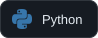
  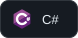
  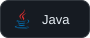
  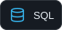
  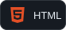
  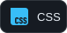
  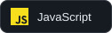

**Data & Visualization**

  
  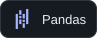
  
  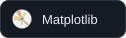
  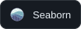

**Machine Learning**

  
  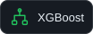
  

**Deep Learning & Vision**

  
  
  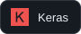
  
  
  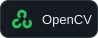
  

**LLMs & Retrieval**

  
  
  
  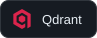

Also used: Datasets, Tokenizers, and Sentence Transformers.

**APIs & Applications**

  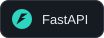
  
  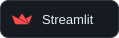
  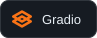
  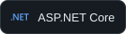

**Database**

  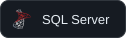

**MLOps & Development**

  
  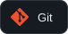
  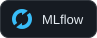
  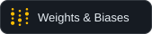
  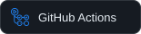
  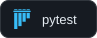

**Environment & Notebooks**

  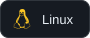
  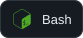
  
  
  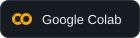
  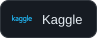

## Contribution Overview

### Contribution Calendar

  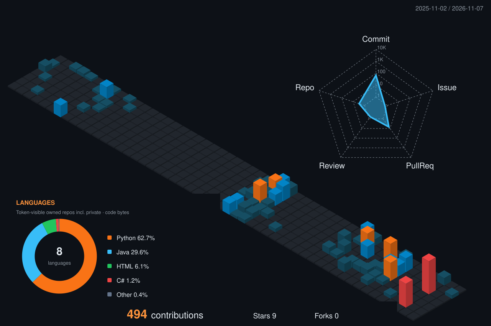

### GitHub Stats

  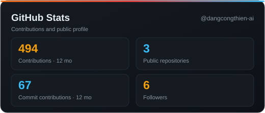

### Contribution Streak

  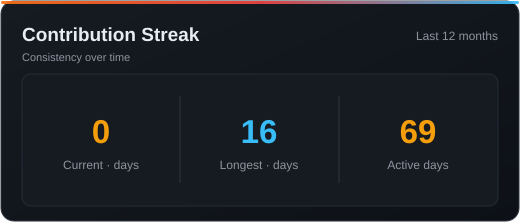

### Weekly Activity

  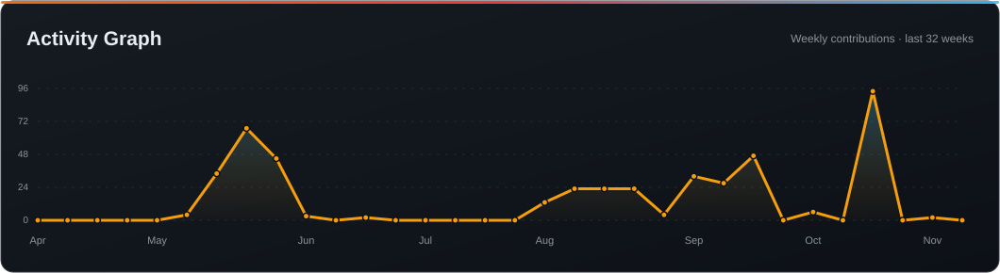

## Connect

  
  
  
  

